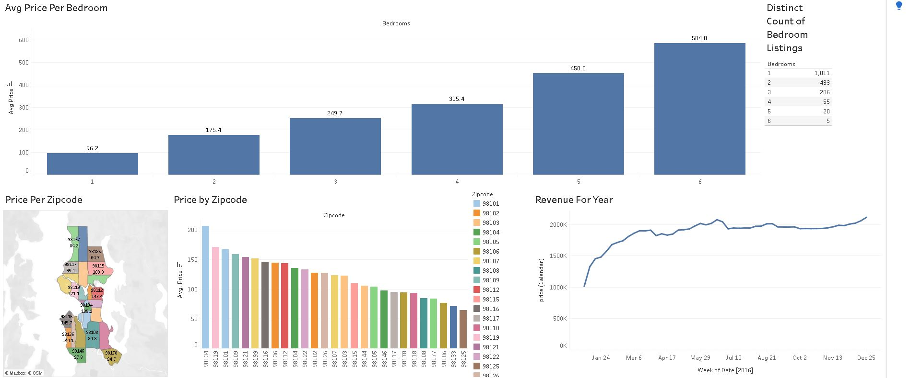

# Seattle Airbnb Dashboard (Tableau)

A beginner Tableau project exploring Seattle Airbnb listings: how price changes with size and location, and how listed prices move across 2016.

**[View the live dashboard on Tableau Public](https://public.tableau.com/app/profile/aliyan.syed/viz/AirBnBBeginnerProject_17940796462090/Dashboard1)**

[]

## Questions I wanted to answer

- How much does the average nightly price rise with each extra bedroom?
- Which Seattle zip codes are the most and least expensive?
- How do listed prices change over the year?

## Data

- **Source:** Airbnb Listings 2016 Dataset https://www.kaggle.com/datasets/alexanderfreberg/airbnb-listings-2016-dataset 
- **Tables used:** `Listings` (3,818 listings, 92 columns) joined to `Calendar` (daily availability and price, Jan 2016 – Jan 2017) on listing ID
- **Not included in this repo:** the raw data is large (the calendar alone is over a million rows), so download it from the source above

## What's in the dashboard

| Chart | What it shows |
|-------|---------------|
| Avg Price Per Bedroom | Average nightly price for 1–6 bedroom listings |
| Distinct Count of Bedroom Listings | How many listings exist for each bedroom count |
| Price Per Zipcode (map) | Average price by Seattle zip code on a filled map |
| Price by Zipcode (bar) | Zip codes ranked by average price |
| Revenue For Year | Weekly total of listed nightly prices across 2016 |

## Key findings

1. **Price climbs steeply with size.** The average goes from about $96/night for 1 bedroom to about $585 for 6 bedrooms, roughly 6x.
2. **Small places dominate.** 1,811 of the listings shown have one bedroom, versus only 5 with six.
3. **Location matters.** Average prices range from about $65 to $207 per night depending on zip code, with 98134 on top and 98125 at the bottom of the chart.

## Limitations (things I found when checking my own work)

- **The Calendar data is incomplete.** I loaded it from Excel, which caps at 1,048,575 rows, so only 2,873 of the 3,818 listings have calendar data. Charts built on the joined data only reflect those listings. Next time I'd load the original CSV files.
- **"Revenue For Year" is not real revenue.** In this dataset a price only appears on nights that are still *available*; booked nights have no price. So the chart sums the listed price of open nights. The rise early in the year mostly reflects bookings filling up near-term dates. A better version would estimate booked nights × average price.
- **Studios are excluded** from the bedroom charts (0-bedroom listings are filtered out).
- **Some zip codes have very few listings** (98134 has 5), so their averages are not reliable. Averages are also pulled up by a few expensive outliers, so median price would be a better measure.

## Next steps

- Clean and aggregate the data in SQL first and include the queries in this repo
- Add room type and review scores to the dashboard

## Tools

Tableau Public, Excel

## Author

Aliyan Syed – [GitHub](https://github.com/aliyan-glitch) · [Tableau Public](https://public.tableau.com/app/profile/aliyan.syed)
